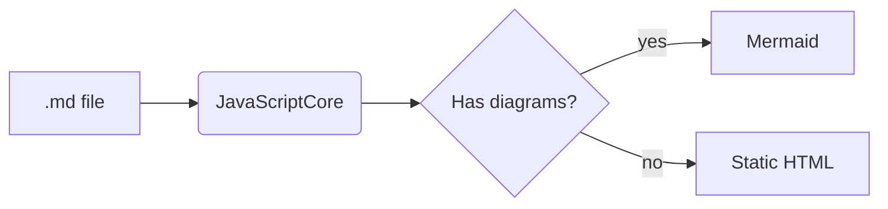
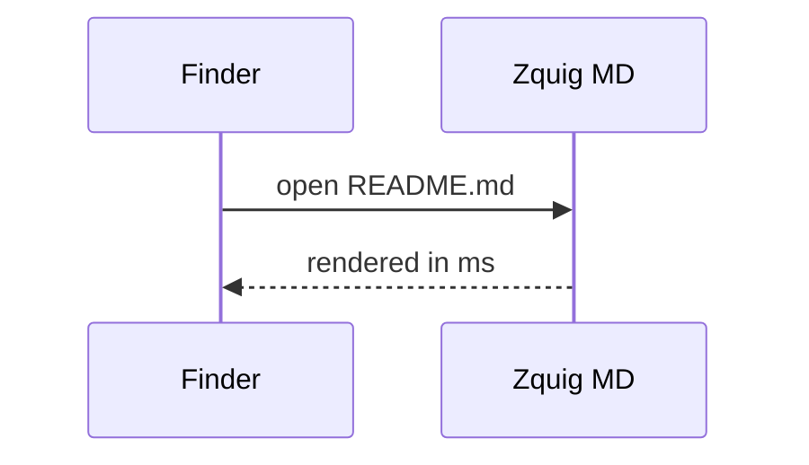

# Footnotes, Math & Diagrams

Markdown viewers should be fast[^speed] and work offline.[^offline]

## Math

Inline math like $E = mc^2$ and $\alpha + \beta = \gamma$ sits in text, while prices like $5 and $10 stay plain.

$$
\int_0^1 x^2\,dx = \frac{1}{3}
$$

```math
\sum_{n=1}^{\infty} \frac{1}{n^2} = \frac{\pi^2}{6}
```

## Diagram



## Sequence



[^speed]: A typical README renders in about 10 ms.
[^offline]: Every library is bundled inside the app.
